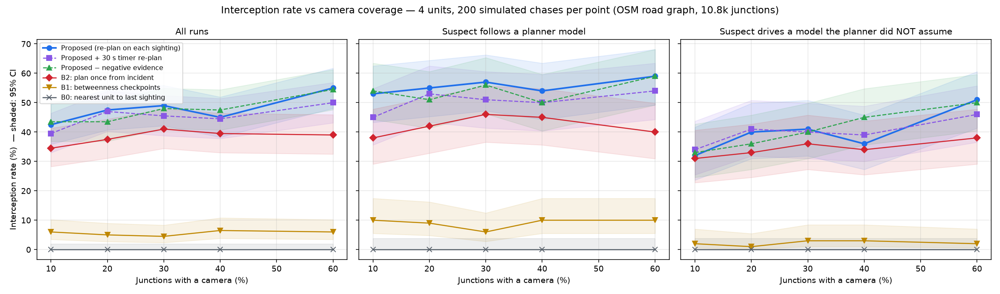

# Where to Wait — re-planning police interception from sparse, uncertain ANPR sightings

[](https://github.com/BhanuPrasadPalella-01/where-to-wait-anpr/actions/workflows/tests.yml)

A student research prototype. Cameras read number plates; this project asks the harder question that
ANPR systems leave open: **given a few uncertain sightings of a wanted car, where should patrol units
wait so they get there first?**

Each sighting is checked for physical plausibility (catches misreads and cloned plates), updates a
particle belief over where the car can be on the road graph, and the units are re-assigned by a
greedy coverage planner. An officer confirms every step; nothing here issues stop orders.



## Headline results (all measured, see [`reports/RESULTS.md`](reports/RESULTS.md))

| | Result |
|---|---|
| Interception, proposed vs plan-once baseline (1,000 paired simulated chases, unseen seeds) | **+9.5 points**, 140 wins / 45 losses, McNemar p = 1.5e-12 |
| Against a fugitive model the planner did not assume | 40.0% vs 34.4% |
| Cloned plate injected mid-chase | belief fooled 93.5% → **6%** with the feasibility gate |
| Greedy planner vs brute-force optimum | ≥ 0.959 (theory: ≥ 0.5), ~5 ms per plan |
| Own Dijkstra / Yen vs NetworkX | identical on 1,000 / 30 random pairs |
| Plate OCR on held-out Indian plates | 44.2% → **75.7%** exact after fine-tuning |
| Fuzzy hotlist match (BK-tree + confusion-weighted distance) | wanted cars caught 70.1% → **87.6%**, 0 innocent cars flagged |
| YOLO26n plate detector | mAP50 0.993 generic test, 0.799 on 47 real Indian photos |

Negative results are reported too: evidence from cameras that did *not* see the car gave no
measurable gain, and the 30 s re-plan timer from the original design made units thrash.

## Layout

```
planner/   roadgraph.py   OSM road graph, own Dijkstra (binary heap) and Yen's K-shortest paths
           fugitive.py    fugitive route models (fastest+2% wrong turns, main-road, random walk, held-out back-streets)
           belief.py      feasibility gate + particle belief (conditioning, rejuvenation, negative evidence)
           plan.py        greedy submodular interception planner + brute-force check; several suspects by severity
           simulate.py    chase simulator, baselines B0/B1/B2, ablations, parallel sweeps
           multi_sim.py   two suspects at once: severity weights, unit locks, split-fleet baseline
           reconstruct.py route reconstruction between sightings (Yen's K paths, space-time feasibility)
           sumo_graph.py  planner graph from a SUMO network
           sumo_sim.py    SUMO/TraCI replication with real traffic (pilot: reports/RESULTS.md section 9)
server/    control_room.py (open cases, gate, belief, shared plan, officer approval, alerts, late-sighting replay),
           messages.py (signed, numbered edge messages), db.py (SQLite store), app.py (FastAPI + WebSocket), static/index.html (Leaflet dashboard), static/unit.html (patrol phone)
edge/      camera_node.py (webcam / phone / video -> YOLO26n -> ByteTrack -> OCR vote -> hotlist -> control room)
scripts/   prepare_data.py, train_plate_detector.py, eval_ocr_baseline.py, indian_plate_format.py,
           hotlist.py, eval_hotlist.py, read_plates.py, plot_results.py, sumo_pilot.py, multi_suspect_table.py
tests/     test_roadgraph.py (vs NetworkX), test_planner.py (gate, belief, greedy vs exact) on the
           city map (skipped if it is missing); test_roadgraph_synthetic.py, test_planner_synthetic.py
           (the same checks on synthetic graphs, always run), test_camera_node.py (OCR vote, read backlog), test_control_room.py (cases, gate, approval,
           camera heartbeat, edge reads; runs on the synthetic grid in synthetic.py, no city map needed),
           test_db.py, test_reconstruct.py, test_control_room_records.py (registry, routes, alerts),
           test_sumo_stops.py (unit stop placement; TraCI part skips without SUMO), test_messages.py,
           test_edge_inbox.py, test_replay.py (signing, duplicates, out-of-order replay),
           test_multi_case.py, test_control_room_cases.py, test_multi_sim.py (several suspects),
           test_own_city.py (study-area options, $WTW_GRAPH),
           test_light_deps.py (tested modules import without torch / OCR / OSMnx / SUMO)
.github/   workflows/tests.yml: CI, the unit tests on every push (Python 3.12, requirements-test.txt)
weights/final/  plate_detector_yolo26n.pt, indian_plate_ocr.onnx (+ config)
reports/   RESULTS.md, fact_check.md, result tables and raw episode logs (.jsonl)
```

## System overview

How each part of the original design maps to the code:

| Original design | Implementation |
|---|---|
| Traffic cameras | `edge/camera_node.py` — any webcam, phone (IP Webcam / Continuity Camera) or video file |
| YOLO + ANPR (vehicle/plate detection) | YOLO26n plate detector + ByteTrack + fine-tuned Indian OCR, one read per vehicle pass |
| Detection processing server | `server/app.py` (FastAPI): camera registration, reads, video streams, WebSocket to the dashboard |
| Database | `server/db.py` (SQLite, `data/control_room.db`): registry, sightings, plate reads, reconstructed routes, alerts, audit log |
| Graph tracking engine | `planner/` — road graph from OpenStreetMap, feasibility gate, route reconstruction, particle belief |
| Police web dashboard | `server/static/index.html` — live map, camera feeds, plate-read log, route history, plan approval |
| Criminal (vehicle) registration | Registry tab: plate, case/FIR number, offence, colour, type, make, severity, officer; 28-day expiry |
| Route prediction | particle belief over three fugitive models → predicted positions; greedy plan of where units wait |
| Live vehicle tracking | sightings from real camera reads; route between sightings rebuilt with Yen's K shortest paths |
| Police alerts & notifications | station alert per sighting; unit assignment alerts on approval; patrol phone page `/unit/<name>` with Acknowledge |

### Database

SQLite file `data/control_room.db` (created on first start, not committed). Registered vehicles need a case
number, offence and officer, and expire after 28 days. Only hotlist hits are kept long term; plate reads
that matched nothing are deleted after a day. Every registration, decision, approval and acknowledgement
is written to the audit log (`GET /api/audit`).

### Route reconstruction

Between two accepted sightings the planner takes Yen's three shortest road paths between the cameras and
keeps those the car could have driven in the observed time (`(1 − σ)·T ≤ Δt`), ranked by how well their
travel time matches the gap. The best path is drawn solid on the map, alternatives dashed; segments are
stored per vehicle and can be replayed later from the Registry tab (**History**).

### Several suspects

More than one case can be open at once (**＋ Add case** next to the plate box, or **＋ Track alongside**
in the Registry). Each case keeps its own belief, feasibility gate and route history, and has a
severity (from the registry entry, else 3; the officer can change it in the case list). One plan covers
every case: a particle of case *c* counts severity(*c*) × its weight, so the greedy planner maximises
severity-weighted coverage (`planner/plan.py` `merge_cases`; still monotone submodular, so the ½
guarantee holds). Once the officer approves a move, that unit is locked to the case it was sent for and
is never pulled to another suspect; closing a case frees its units. Camera reads go to the case of the
matched plate; the officer's focus (the case shown in detail) does not change. Each case's predicted
positions have their own colour on the map.

### Police alerts

Approving a plan sends each moved unit an assignment alert; each accepted sighting alerts all stations;
interception or escape is broadcast to all units. Patrol units open `http://<server>:8000/unit/Unit%201`
on a phone: assignment, ETA, wanted-vehicle details with the plate photo, map, and **Acknowledge**.
An assignment not acknowledged within 30 s is flagged on the dashboard.

## Quick start

```bash
python3 -m venv .venv
.venv/bin/pip install -r requirements.txt
.venv/bin/python -m pytest -q tests                # all unit tests; city-map tests skip until the map exists
# tests only (what CI installs): .venv/bin/pip install -r requirements-test.txt
.venv/bin/python -m planner.roadgraph            # download the OSM road graph (Hyderabad; see "Your own city")
.venv/bin/python -m tests.test_roadgraph         # full-size runs on the city map, with timings
.venv/bin/python -m tests.test_planner
.venv/bin/python -m planner.simulate --name demo --coverages 0.1,0.3 --runs 50
.venv/bin/python scripts/plot_results.py demo
.venv/bin/python -m planner.multi_sim --name multi_suspect --runs 200   # two suspects, 5 methods
.venv/bin/python scripts/multi_suspect_table.py reports/multi_suspect.jsonl
```

Control-room dashboard (live demo): `.venv/bin/python -m uvicorn server.app:app --port 8000`, open
http://localhost:8000, press **Start demo chase**. Sightings appear, the predicted area spreads, the
officer approves each plan, units drive to their junctions; **Inject cloned plate** shows the
feasibility gate flagging an impossible journey, **Camera offline** marks a camera blind. Real edge
cameras post signed reads to `POST /api/edge/read` (see "Edge messaging" below); `POST /api/sighting`
(`{"camera": <junction>, "plate": "...", "score": 0.93}`) is an unsigned manual entry, refused when
`WTW_EDGE_KEY` is set.

### Your own city

The default study area is 3 km around Abids, Hyderabad. To use another city, download its drivable
road network from OpenStreetMap (needs `osmnx`, in `requirements.txt`; a few MB of JSON):

```bash
.venv/bin/python -m planner.roadgraph --center 12.9716,77.5946 --radius 2500 --out data/bengaluru.json
```

`--center` is `LAT,LON` in decimal degrees, `--radius` metres around it; without `--out` the graph
replaces `data/city_graph.json`. The file records the center and radius it was built from. Then point
everything at it:

* simulator: `python -m planner.simulate --graph data/bengaluru.json ...` (also `planner.multi_sim`), or
  `--center 12.9716,77.5946 --radius 2500` to download that area into `data/city_<lat>_<lon>_<r>m.json`
  on first use and reuse it after;
* control room: `WTW_GRAPH=data/bengaluru.json .venv/bin/python -m uvicorn server.app:app --port 8000`;
  the dashboard map follows the graph. Edge nodes get their junction when they register, so restart
  them after switching city (a fixed `--junction` id belongs to the old map);
* tests: `tests.test_roadgraph` and `tests.test_planner` always use `data/city_graph.json`.

Larger radii grow the graph roughly with the area and slow the planner (3 km gives ~10,800 junctions).
`data/` is git-ignored, so maps are never committed.

## Live demo

Real cameras reading real plates, no simulated chase: start the control room, then one edge node per
camera (Mac webcam, iPhone via Continuity Camera, an Android phone running "IP Webcam", or a video file):

```bash
.venv/bin/python -m uvicorn server.app:app --host 0.0.0.0 --port 8000
.venv/bin/python -m edge.camera_node --name cam-A --source 0
.venv/bin/python -m edge.camera_node --name cam-FAR --role far --source http://PHONE_IP:8080/video
```

Each node tracks plates with ByteTrack, reads the three sharpest crops of every track, votes over the
OCR strings and fuzzy-matches the hotlist served by the control room. Every read appears in the
dashboard's read log; only hotlist matches become sightings on the map. A `--role far` camera shows the
cloned-plate check, and a camera whose stream stops for 5 s is marked blind. Reads made while the
control room is down are queued on the node and replayed. Full script and tips: [`DEMO.md`](DEMO.md).

### Edge messaging

Every read a node sends is numbered and signed (`server/messages.py`): the node's random boot id, a
sequence number, and an HMAC-SHA256 over the canonical JSON with a key shared by the nodes and the control
room (`WTW_EDGE_KEY`, or `--key` on the node). The control room

* drops a read with a missing or wrong signature (HTTP 401; the node logs it and moves on),
* drops a read whose (camera, boot, seq) it already processed — a retry after a lost reply,
* dates each sighting by its **capture** time on the node, not its arrival time, and
* when a sighting arrives after one captured later (a queue flushed after an outage, a slow link), rolls
  the belief back to a snapshot taken before that later sighting and replays all of them in capture
  order. A verdict can change on replay (a read that looked fine may become an impossible journey once
  the earlier one is known); changes are logged, stored, and the officer gets one new plan.

While the control room is unreachable the node keeps up to 2,000 reads, dropping the oldest non-match
first. Without a key everything still works, unsigned (fine for a tabletop demo, not for a network).
Node clocks are assumed roughly in sync (NTP); a capture time in the future is clamped to "now".

Perception: `scripts/prepare_data.py` downloads the public datasets; `scripts/read_plates.py <images>`
runs detector + OCR end to end with the weights in `weights/final/`.

## Status

* Done: perception (detector, Indian OCR, hotlist), road graph + own algorithms, gate, belief,
  planner, chase simulator with baselines, coverage / clone / fleet-size experiments.
* Done: control-room dashboard (FastAPI + WebSocket + Leaflet) with officer approval, clone flagging,
  camera-offline handling and a demo chase.
* Done: live mode with real edge cameras (`edge/camera_node.py`, [`DEMO.md`](DEMO.md)).
* Done: pytest tests for the control room on a synthetic grid graph.
* Done: graph-free Dijkstra/Yen and greedy-vs-exact tests; city-map tests skip when the map is missing.
* Done: GitHub Actions CI running the unit tests on every push (CPU only, no downloads).
* Done: SUMO replication runs without TraCI errors; 160-episode pilot in normal and peak traffic.
* Done: signed, numbered edge messages; duplicates dropped; late sightings replayed by capture time.
* Done: several suspects at once — severity-weighted shared plan, units locked to their case,
  dashboard case list; two-suspect simulator experiment (reports/RESULTS.md section 10).
* Done: any city — `--center/--radius` for the road graph and simulators, `$WTW_GRAPH` for the
  control room.
* Next: see [`ROADMAP.md`](ROADMAP.md) — fine-tune the plate detector on own photos.

## Data and ethics

Datasets are not redistributed: Roboflow licence-plate set (CC BY 4.0), Datacluster Indian plates
(CC BY-NC-ND 4.0, test only), zenitsu09 Indian plate crops (licence not stated). The design keeps a
human officer in the loop, alerts only above a confidence threshold, and keeps only hotlist hits —
see the Aurora (2020) wrongful-stop case in `reports/fact_check.md`.

## Licence

AGPL-3.0 (required by Ultralytics YOLO, which this project uses).
